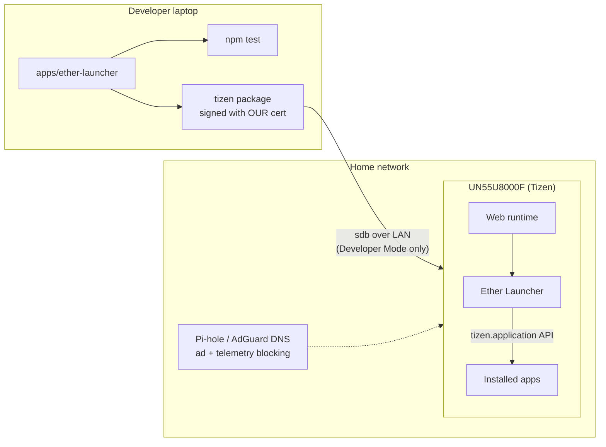

# Overview, architecture and limits

## What we're working with

- **TV:** Samsung UN55U8000F (Crystal UHD, "F" = 2025 model line).
- **OS:** Tizen, a Linux-based OS. The exact version is listed in Settings, see
  [01-identify-tv.md](01-identify-tv.md). 2025 sets ship Tizen 9.x. The Tizen 7 and later
  web runtime is a modern Chromium, so current JavaScript (ES2020+, modules) works.
- **App model:** TV apps are packaged as signed `.wgt` web apps (HTML/JS/CSS). Native
  `.tpk` apps are restricted to Samsung partners on current TVs, so we use web apps.

## Architecture

## Hard limits (and why)

| We do | We do not |
|---|---|
| Use Samsung's official Developer Mode to sideload our own apps | Bypass firmware signature checks, secure boot or the TV's integrity checks |
| Analyse publicly downloadable firmware **off the device** | Flash modified firmware to the TV |
| Block telemetry/ads at the network (DNS) level | Defeat DRM (e.g. Widevine/PlayReady) or access paid content without paying |
| Change settings Samsung exposes, all of which can be undone | Use exploits against the TV or services Samsung runs |

**Why:** Flashing modified firmware or bypassing secure boot is the main way people brick
current Samsung sets, and it voids the warranty. Exploit chains for these TVs also tend to stop
working with the next automatic update. The approved path gets you about 90% of the practical
value (custom apps, debloating, faster navigation) with no risk to the hardware. Getting around
DRM also carries legal risk (DMCA §1201 in the US, Copyright Act s.41.1 in Canada), even
on hardware you own.

## Data map (per the data-aware-by-design guideline)

| Data | Classification | Collected by us? | Where it flows |
|---|---|---|---|
| App launcher config (app IDs, labels) | Zero-party (user-entered) | Yes, stored locally on the TV only | `localStorage` on the TV; never leaves the device |
| Usage events (which tile was opened) | First-party | **No.** Analytics hook is OFF by default | If someone enables it: a function you supply. There is no built-in endpoint |
| Samsung telemetry (ACR/"Viewing Information Services") | Third-party | N/A | Samsung servers. We switch it off ([03](03-performance-debloat.md)) |
| TV IP address, Developer Mode host IP | Network identifier | Used only on the LAN | Laptop ↔ TV over the LAN |
