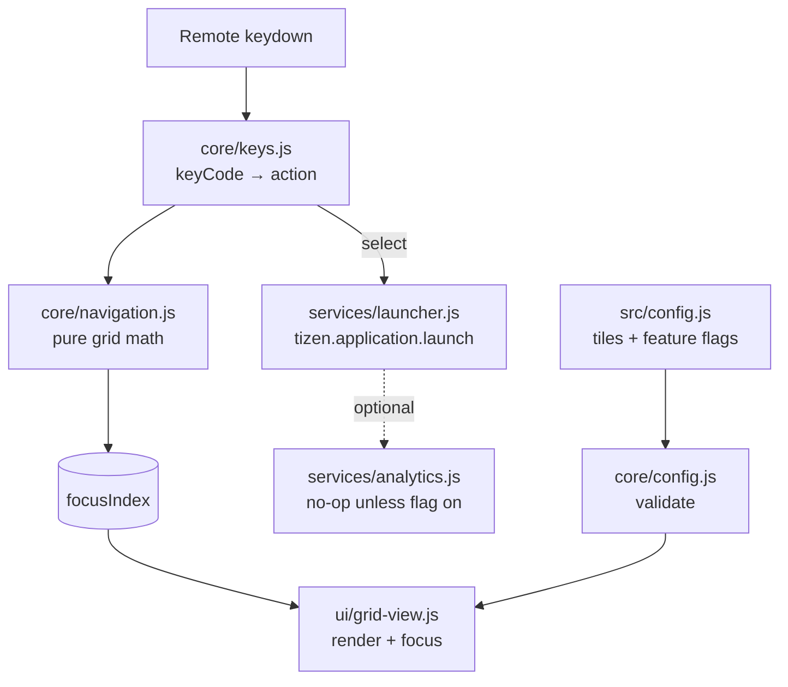

# 5. Custom app: Ether Launcher

A fast, config-driven launcher grid for the TV. It shows how a Tizen web app is structured and
is the base for later features (media player, home dashboards, etc.).

## How it works

**Separation of concerns**

| Layer | Folder | Touches DOM / Tizen APIs? | Tested by |
|---|---|---|---|
| Logic | `src/core/` | No, pure functions | unit tests |
| Presentation | `src/ui/` | DOM only | integration test (fake DOM) |
| Side effects | `src/services/` | Tizen APIs, injected | unit tests with fakes |
| Wiring | `src/main.js` | Composes the above | integration test |

## Extending

- **Add an app tile:** add `{ id, label, appId }` to `tiles` in `src/config.js`. To find
  app IDs, `sdb shell 0 vd_applist` (Developer Mode) lists them, or open the store page.
  Common IDs are already in the config.
- **Add a URL tile** (e.g. a Home Assistant dashboard): `{ id, label, url }`. The app
  opens it in the TV browser.
- **New feature:** add a flag under `features` in `src/config.js`, default `false`, and check it
  where it's used. Ship dark, then turn it on.
- **Analytics/CDP hook:** set `features.analytics = true` and pass a `sink` function to
  `createAnalytics()` in `main.js`. Events are `{ type, tileId, ts }`, contain no PII, and
  are classified first-party.

## Remote key codes (Tizen)

| Key | keyCode | Action |
|---|---|---|
| ← ↑ → ↓ | 37 38 39 40 | move |
| OK | 13 | select |
| Back | 10009 | exit app |
| Backspace/Esc (desktop preview) | 8 / 27 | back |

## Known uncertainties

- The App IDs for Netflix, YouTube and others in `config.js` are the widely published
  ones. Check them on your TV with `vd_applist`. Samsung occasionally changes them.
- The `tizen.application.launch` privilege needs the `application.launch` privilege
  declared in `config.xml` (done).
