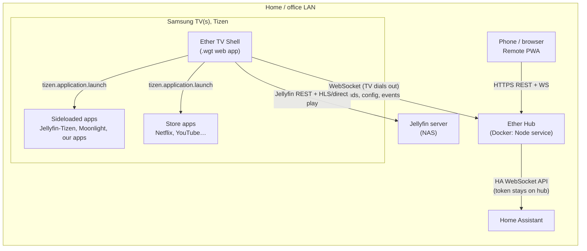
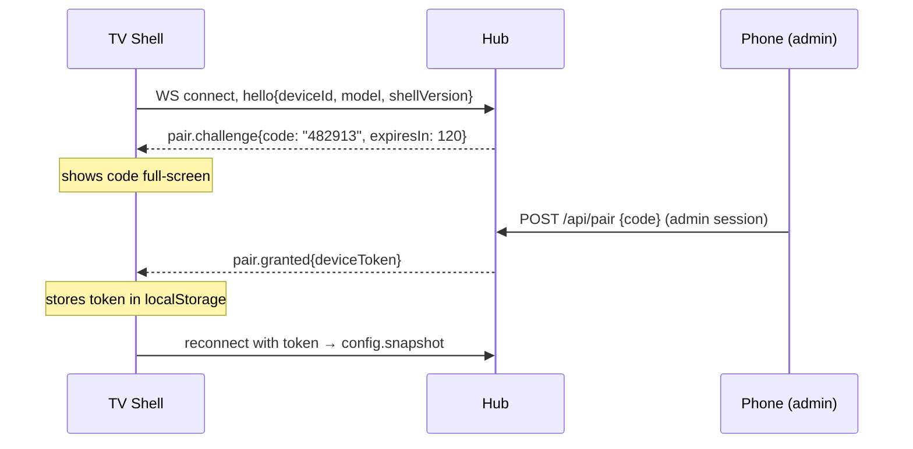
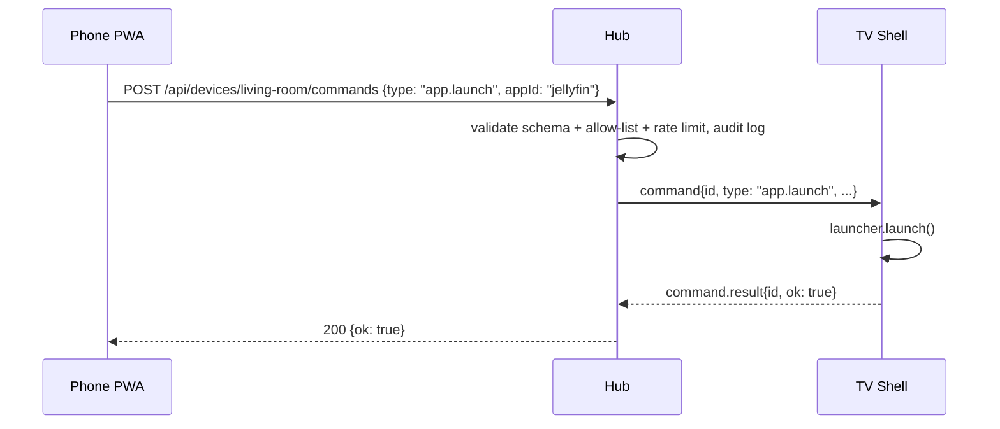

# Ether TV: system architecture

**Status:** Proposed · **Scope:** household/office TVs we own (no cloud, no customer accounts)
**Target hardware:** Samsung UN55U8000F (Tizen), plus any other Tizen TVs on the LAN

## 1. Goals

| # | Capability | What "done" looks like |
|---|---|---|
| G1 | Fast home/launcher | Remote key → focus change in **< 50 ms**; shows apps, inputs, favourites |
| G2 | Media hub | Browse and play our own media (NAS/Jellyfin, IPTV) ad-free in one UI |
| G3 | Smart-home dashboard | Home Assistant entities/cameras on screen; doorbell/alerts as an overlay over any app |
| G4 | Phone/remote API | Phone (or automation) can open an app, cast a URL, show a message, run a scene |
| G5 | Custom + non-store apps | Install our own apps and open-source TV apps not in Samsung's store |

**Non-goals:** replacing Samsung firmware; running Android/APK apps (Tizen can't run them; see §7);
bypassing DRM; multi-tenant/customer use.

## 2. System context



### Why a hub?

A Tizen web app **can't listen on a network port**, so phones can't talk to the TV directly.
The TV opens a WebSocket **outbound** to the hub, and the hub relays commands to it. The
hub is also the only place that holds secrets (the Home Assistant token), so a TV never stores
credentials that could control the house. See [ADR-0002](adr/0002-lan-hub-outbound-websocket.md).

**Crawl without the hub:** the shell works standalone (launcher + media) using bundled config.
The hub adds G3/G4 and centralised config. Each TV has a `hub.enabled` feature flag.

## 3. Components

### 3.1 Ether TV Shell (on the TV)

Evolves the current `apps/ether-launcher`. One `.wgt` app that hosts **modules**. Details: [tv-shell.md](tv-shell.md).

| Module | Capability | Phase |
|---|---|---|
| `home` | Launcher grid: apps, inputs, favourites, URL tiles | Crawl |
| `media` | Jellyfin browse + play (AVPlay) | Walk/Run |
| `dashboard` | Home Assistant cards, camera snapshots | Walk |
| `overlay` | Toasts/doorbell over **any** app (see uncertainty U2) | Walk |
| `remote-link` | Hub connection, pairing screen, command dispatch | Walk |

Shared core (already built and tested): key mapping, grid navigation, config validation.

### 3.2 Ether Hub (always-on box, Docker)

A small Node service, with no database in the crawl/walk phases (JSON files on a volume).

| Responsibility | Notes |
|---|---|
| Device registry + pairing | 6-digit code shown on TV → entered on phone → per-device token |
| Config service | One `ether.config.json` for all TVs; per-TV overrides; pushed live over WS |
| Command relay | Phone/automation → validated command → target TV(s) |
| HA bridge | Subscribes to selected HA entities; forwards state/events to TVs; executes allow-listed services |
| Remote PWA | Static phone UI served by the hub |
| Audit log | Command log, 7-day rolling retention |

API and message protocol: [hub-api.md](hub-api.md). Message schemas are in code at
[`packages/protocol`](../../packages/protocol), shared by the TV shell, hub and PWA, and unit-tested.

### 3.3 Non-store app pipeline (G5)

```
apps/catalog/<app>/source.json   → pinned git repo + commit/tag + build recipe
scripts/build-catalog-app.sh     → clone at pinned ref → build → sign with OUR cert → .wgt
scripts/sideload.sh              → install to TV(s)
```

Initial catalog candidates: **Jellyfin-Tizen** (media), **Moonlight** (PC game streaming).
We build everything from pinned source, so we know what runs on the TV (supply-chain control).
Our own apps are either **shell modules** (preferred: shared navigation, one install) or
separate `.wgt`s when they need isolation.

## 4. Key flows

### 4.1 Pairing a TV



### 4.2 Phone opens Jellyfin on the living-room TV



### 4.3 Doorbell → overlay

HA event `binary_sensor.doorbell → on` → hub (subscribed) → `overlay.show{title, imageUrl, ttl}`
to all TVs whose config subscribes to `doorbell` → TV shows a toast + camera snapshot for 15 s.

## 5. Performance budgets

| Metric | Budget | How we enforce it |
|---|---|---|
| Key press → focus visible | < 50 ms (target: 1 frame) | Transform/outline-only focus, no layout on navigation; on-device timing harness (U4) |
| Shell cold launch → interactive | < 1.5 s | No framework, no build-time bloat, total JS < 100 KB, images lazy |
| Shell memory | < 150 MB | Modules unmount when hidden; one module active at a time |
| Hub command → TV action | < 300 ms on LAN | Persistent WS, no polling |
| Shell with hub down | Fully usable (launcher, media) | Hub features degrade gracefully; reconnect with backoff |

## 6. Security and privacy

| Threat | Control |
|---|---|
| Someone on the LAN sends commands to a TV | Commands only via hub; per-device and per-client tokens from pairing; schema + **allow-list** validation; rate limit |
| Stolen TV token | Token can only *receive* commands and fetch its config. It can't issue commands or touch HA. Revocable on the hub |
| HA token compromise | HA long-lived token lives **only** on the hub (Docker secret), scoped to a dedicated HA user with access only to the entities we use |
| Command injection (e.g. `url.open` to `javascript:`) | Shared protocol validator: http(s) only, length limits, enum types |
| Eavesdropping on LAN | Walk: TLS via real cert on a subdomain we control (DNS-01, resolves to LAN IP), so TVs and phones trust it with no custom CA (see U3). Crawl (hub not yet deployed): no network traffic |
| Supply chain (sideloaded apps) | Build from pinned commits only; signed with our cert |
| Cameras on TV screens | Snapshots only on demand/event, not stored on the hub; explicit per-TV opt-in flag |

**Data inventory**

| Data | Class | Stored where | Retention |
|---|---|---|---|
| TV/app config, favourites | Zero-party | Hub volume + TV localStorage | Until changed |
| Device + client tokens | Credential | Hub (hashed), TV/phone localStorage | Until revoked |
| Command audit log (who/what/when, no payload content beyond type + target) | First-party | Hub volume | 7 days |
| HA entity states | First-party (home telemetry) | In memory only | Not persisted |
| Watch history | First-party | Jellyfin (existing), not duplicated | Jellyfin settings |
| Camera snapshots | First-party, sensitive (may include people) | Not persisted; streamed through | 0 |

Analytics/CDP: no external pipeline (internal use). The `analytics` hook stays a no-op. If we
ever turn it on, it goes to the hub's local log.

## 7. Constraints and technical uncertainties (SR&ED)

| ID | Uncertainty | Plan to resolve |
|---|---|---|
| U1 | Can a public (non-partner) Samsung certificate access `tvinputdevice`, `tvwindow` / input-source switching (HDMI tiles) on Tizen 9? | Spike: minimal `.wgt` that requests each privilege and logs results |
| U2 | Can a web app show an overlay **on top of another running app**? Tizen normally gives the foreground app the whole screen | Spike. Fallback: bring shell to foreground for alerts, then relaunch the previous app |
| U3 | Does the TV web runtime accept WSS to a LAN IP with a public cert (split-horizon DNS)? | Spike with a test subdomain |
| U4 | Real key-to-paint latency on the U8000F, and whether 50 ms is achievable with the shell | On-device timing harness using `performance.now()` + `requestAnimationFrame` |
| U5 | AVPlay vs `<video>` + hls.js for Jellyfin playback: codec coverage and performance | Compare on device with sample files (H.264/HEVC/AV1, SDR/HDR) |
| U6 | Does the shell keep its WS alive in the background, or must the hub queue commands? | Spike. Design assumes queue + replay on reconnect (TTL 30 s) |
| — | **Android apps** | Not possible on Tizen. Use the web version (URL tile), a Tizen port, or an external box (Plan B) |

## 8. Decisions

- [ADR-0001](adr/0001-web-app-shell.md): one Tizen web app shell with modules
- [ADR-0002](adr/0002-lan-hub-outbound-websocket.md): LAN hub; the TV dials out over WebSocket
- [ADR-0003](adr/0003-jellyfin-media-backend.md): Jellyfin as media backend (don't build one)
- [ADR-0004](adr/0004-no-ui-framework.md): no UI framework in the shell
- [ADR-0005](adr/0005-shared-protocol-package.md): shared, validated message protocol

Roadmap: [roadmap.md](roadmap.md)
