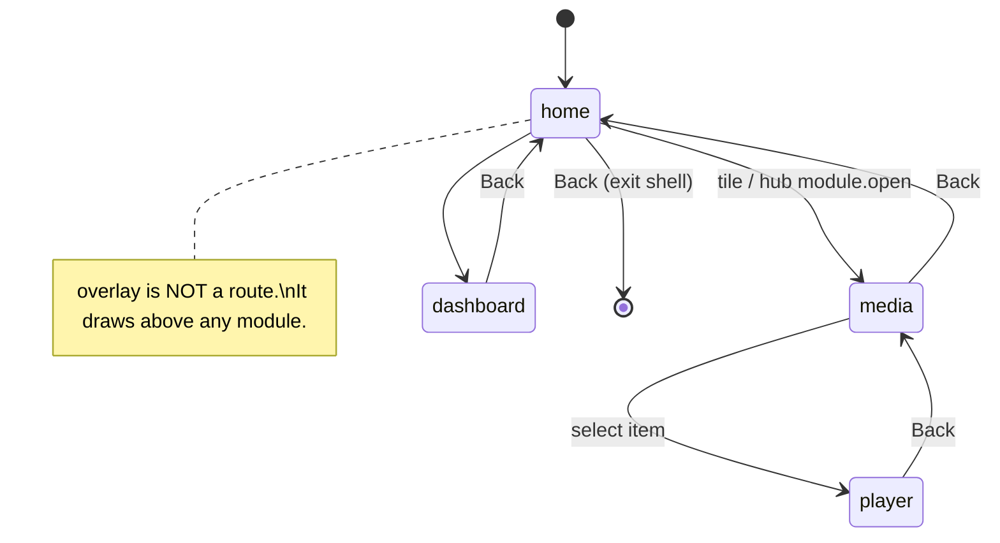

# Ether TV Shell: design

The on-TV app. It grows out of `apps/ether-launcher` and keeps the same layering:
**core** (pure logic) → **ui** (DOM) → **services** (Tizen/network side effects), wired in `app.js`.

## Module contract

Every feature (home, media, dashboard, overlay…) is a module with the same interface.
The shell owns routing, the Back stack and key dispatch. Modules don't touch globals.

```js
/** @typedef {object} ShellModule
 * @property {string} id                      'home' | 'media' | 'dashboard' | ...
 * @property {string} title
 * @property {string} flag                    feature flag that enables it, e.g. 'modules.media'
 * @property {(el: HTMLElement, ctx: ModuleContext, params?: object) => void|Promise<void>} mount
 * @property {() => void} unmount             release timers, listeners, video. Required (memory budget)
 * @property {(action: Action) => boolean} handleAction   true = consumed; false = shell handles (e.g. Back)
 */

/** @typedef {object} ModuleContext   (capabilities, injected → testable with fakes)
 * @property {{ launch(tile): Promise<void> }} launcher
 * @property {(moduleId: string, params?: object) => void} navigate
 * @property {{ get(key): any, subscribe(fn): () => void }} config
 * @property {{ send(msg): void, on(type, fn): () => void, connected: boolean }} hub   (no-op stub when hub disabled)
 * @property {{ track(type, data): void }} analytics
 */
```

## Routing and Back



- A stack of `{moduleId, params}`. Back pops it; Back on `home` exits the app.
- One module mounted at a time (memory budget). Modules restore their focus from `params` when remounted.

## Key dispatch order

1. **Overlay** (if visible): OK dismisses or acts; Back dismisses.
2. **Active module** `handleAction(action)`.
3. **Shell**: Back → pop route; colour keys → configurable shortcuts (e.g. Red = Dashboard).

Colour/media keys must be registered via `tizen.tvinputdevice.registerKey` (privilege check is in U1).

## Home module (evolves the current launcher)

Rows, each one a horizontal list using the existing `nextIndex` grid math:

| Row | Source |
|---|---|
| Continue watching | Jellyfin `/Users/{id}/Items/Resume` (when `modules.media` is on) |
| Apps | config `tiles` (store, sideloaded and URL tiles) |
| Inputs | HDMI 1–3 (pending U1) |
| Home | 3–4 pinned HA entities (when hub connected) |

## Media module

- Browse: Jellyfin libraries → poster grid (lazy images, fixed-size tiles to avoid relayout).
- Play: AVPlay (`webapis.avplay`) for direct play of HEVC/HDR, falling back to `<video>` (decided by U5).
- Auth: Jellyfin API key **per TV user**, stored on the TV. It's media-only and low risk, so it doesn't need the hub.

## Dashboard module

Card types: `entity` (state + toggle), `camera` (snapshot, refresh on focus), `scene` (button).
All HA calls go **through the hub** (`ha.call` command), never directly. The TV has no HA token.

## Performance rules (enforced in code review)

- Navigation changes only `transform`, `opacity` and `outline`. Never width/height/top/left.
- No layout reads (`offsetWidth`, `getBoundingClientRect`) inside key handlers.
- Images: fixed `width`/`height` attributes, `loading="lazy"`, server-side resized (Jellyfin `?maxWidth=`).
- Each module's `unmount()` must clear intervals and pause/release video (tested).
- Bundle budget: JS < 100 KB unminified across all modules for the crawl/walk phases.

## Folder layout (target)

```
apps/ether-shell/
  src/core/        keys, navigation, router (pure)
  src/modules/     home/, media/, dashboard/, overlay/  (each: index.js + view.js + tests)
  src/services/    launcher, hub-client, jellyfin-client, analytics
  src/app.js       shell wiring
  src/boot.js      globals → app
```

The current `ether-launcher` becomes `ether-shell` in phase 1 (rename + module extraction; existing tests keep passing).
